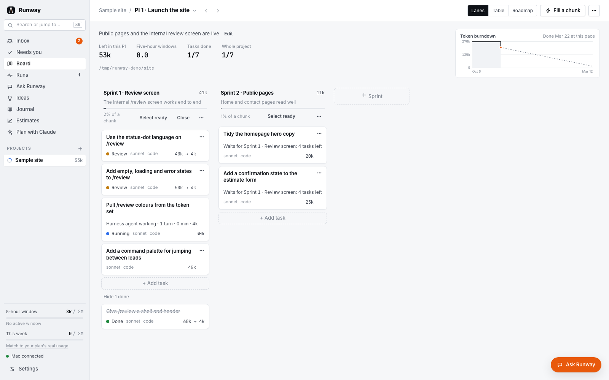
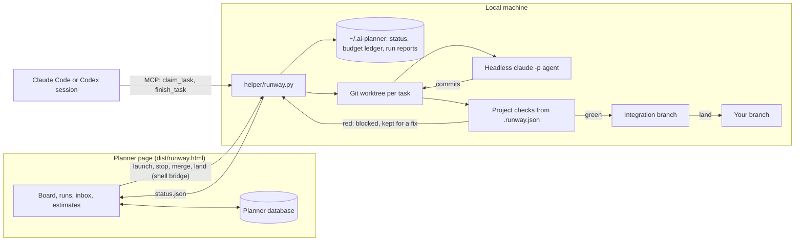

# runway

A token-budgeted planner that launches headless Claude Code agents in chunks, merges their work through a checked merge train, and can run a roadmap unattended under a dollar cap.



*The planner page running in the local harness with sample data. The runs shown used the harness's stand-in agent (`harness/fake_claude.py`), not a live model.*

## What it does

- **Plans work as token-estimated tasks.** Projects break into program increments, sprints and tasks, each with an estimate. The page tracks a five-hour window and a weekly token budget, groups tasks into chunks sized to a token budget, and stops an agent that runs far past its calibrated estimate.
- **Launches agents in chunks.** Each task gets its own git worktree and branch, and a headless `claude -p` run. A local helper tracks status, usage and stalled runs.
- **Merges through a train.** Finished work runs the project's own checks (from `.runway.json`), merges onto an integration branch, and lands on your branch when you say so.
- **Runs unattended under a dollar cap.** Autopilot takes a brief, generates a roadmap for review, then launches and merges task after task. It stops when the queue is done, when something blocks, or when the next task's projected cost would pass the cap.
- **Hands work to interactive sessions.** The helper is also a stdio MCP server, so a Claude Code or Codex session can claim a ready task, work in its worktree and hand it back through the same merge gate.

## Architecture



The page is one HTML file with the helper embedded in it. It reaches the machine only through a shell bridge (in the author's setup, a desktop MCP server; in this repo, the sandboxed harness). The helper is plain Python with no third-party packages.

## Quick start

No accounts or keys. Needs Python 3, git, Node and Chrome or Chromium (for the page checks).

```bash
git clone https://github.com/AustinGailey/runway && cd runway
python3 build.py                 # builds dist/runway.html and checks it
./test.sh                        # creates .venv with pytest on first run, then runs the suite
python3 harness/serve.py --port 8765 --seed harness/demo-seed.json
```

Open http://127.0.0.1:8765/ and you have the planner with a sample project. Everything it does happens in a temporary sandbox: a scratch git repo, a temp `HOME`, and a stand-in `claude` that spends no tokens. Open the board, select tasks and launch them, then merge them, to see the whole loop.

`python3 build.py --render` also loads the page in headless Chrome and saves `dist/render-check.png`.

Using it for real means installing the helper to `~/.ai-planner/runway.py`, having the `claude` CLI on your path, and giving the page a shell bridge. That part needs your own Claude account and is not covered by the quick start. See [docs/AUTOPILOT_RUNBOOK.md](docs/AUTOPILOT_RUNBOOK.md), [docs/MERGE_TRAIN_RUNBOOK.md](docs/MERGE_TRAIN_RUNBOOK.md), [docs/config.md](docs/config.md), [docs/task-environments.md](docs/task-environments.md) and [docs/mcp.md](docs/mcp.md).

## What is measured

Every figure here says how it was produced. Test runs are called test runs.

| Claim | How it was produced |
| --- | --- |
| **7 of 7 chunks merged unattended, zero manual git commands** (2026-10-08) | A test run, **not live Claude agents**. Each task's edit came from a **scripted agent**, the roadmap came from a canned planning reply, and the repo was a **seeded throwaway git repo** under `/tmp`. The real code paths that ran were roadmap parsing and validation, approval, the `autopilot()` loop, worktree creation, the merge gate, the budget ledger and the run report. Source: [docs/GO_NO_GO.md](docs/GO_NO_GO.md) and [the run report](docs/reports/2026-10-08-sample-site-autopilot-run.md). |
| **$1.065 spent of a $1.50 cap (71%)** in that run | Computed by the real pricing and ledger code from **injected token counts**, not from real usage. No real tokens were spent. The program's own target was spend within ±15% of the cap; this run came in 29% under it, and the go/no-go document records that as a pass. |
| **0.02 minutes of machine time** in that run | Git and merge time only. The scripted agent has no delay, so this says nothing about how long a real run takes. |
| **Merge train trial: 5 tasks through the train, including a red check and a conflict** (2026-10-04) | A test run in a scratch repo with scripted commits standing in for agents. Source: [the trial report](docs/reports/2026-10-04-merge-train-trial.md). |
| **740 tests pass** | `./test.sh` in this repo on 2026-11-12 (macOS, Python 3.14, Node 23, Chrome present), run from a clean export of the published files. The suite uses temp-dir git repos and the stand-in agent; it never calls a model. |

Not measured: a full unattended run with live agents, wall-clock time for real runs, review time, and any time saved against doing the same work by hand. The reports say so in their own "Not covered" sections.

## Limits

- **Built for one person on one Mac.** State lives in `~/.ai-planner` and the defaults assume macOS. A CI workflow is set up to run the tests on Linux, but it has not run on the public repo yet, and real use off macOS is untested.
- **The page expects a host.** It was written to run inside a Claude artifact that provides a database and a shell bridge. Outside that, this repo gives you the harness, which is a sandbox for trying and testing it, not a production host.
- **The dollar cap is a launch gate, not a hard ceiling.** Autopilot checks projected cost before each launch. A task that runs far over its estimate can push spend past the cap.
- **Estimates drift.** Token estimates are calibrated from past runs per model and task kind. With few runs the calibration is rough, and the run report flags drift rather than correcting for it mid-run.
- **Some features point at tools you may not have.** The vault export, the Notion inbox and the "Ask Runway" assistant need a notes folder, a Notion connection and a model connection. The private defaults for these were removed from this copy.
- **Claude Code only as the launched agent.** Codex can claim tasks through MCP, but launched runs call the `claude` CLI.
- **The docs are working notes.** The runbooks and reports under `docs/` were written during the build and keep their original shape, with private project and site names replaced.

## Part of a set

I build internal AI platforms. The other pieces:

- [mcp-gateway](https://github.com/AustinGailey/mcp-gateway): single sign-on, role-based tool access and an audit log for MCP servers
- [tokenwise](https://github.com/AustinGailey/tokenwise): LLM cost gateway with caching and a savings ledger
- [runway](https://github.com/AustinGailey/runway): planner that runs coding agents under a token budget
- [take-one-pipeline](https://github.com/AustinGailey/take-one-pipeline): multi-agent pipeline with independent QA gates
- [lodestar](https://github.com/AustinGailey/lodestar): reliability layer for agent-built software
- [claude-cost-engineering](https://github.com/AustinGailey/claude-cost-engineering): prompt caching as a team default

## License

[MIT](LICENSE)
